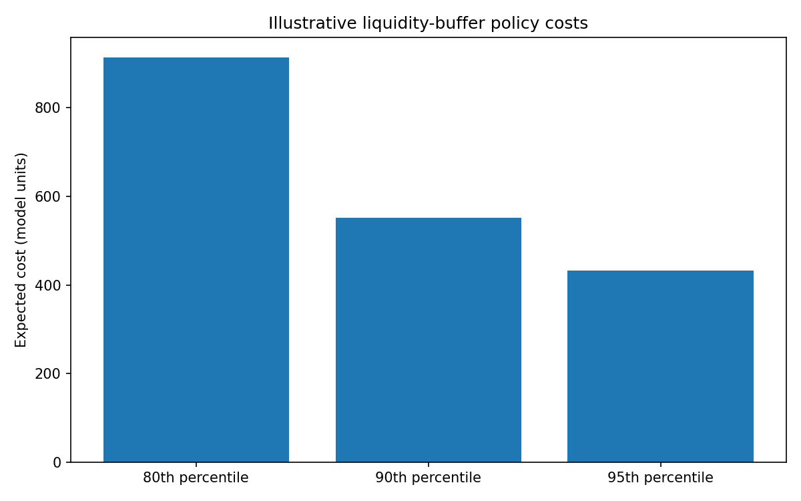

# DepositSense — Retail Deposit Stability & Liquidity Risk Analytics

A Python-based banking analytics project that uses simulated account-level data, statistical inference, Bayesian updating and Monte Carlo simulation to investigate retail deposit stability and liquidity risk.

## The Banking Problem

How much of a bank's retail deposit base can reasonably be treated as stable, and what liquidity buffer should it prepare if customer withdrawals increase?

Customers may withdraw funds, transfer money or move savings in response to changing financial circumstances and competing interest rates. DepositSense investigates how these behaviours can affect funding stability.

## What the Project Does

- Generates synthetic daily account-balance data across customer segments.
- Analyses deposit stability, withdrawal rates and deposit concentration.
- Estimates uncertainty around average outflows using confidence intervals and bootstrap resampling.
- Uses Beta–Binomial Bayesian updating to estimate material-outflow probabilities.
- Examines aggregate deposit trends using least-squares regression.
- Simulates 30-day net deposit outflows under baseline and stress scenarios.
- Compares liquidity buffers and their illustrative costs.
- Produces charts and a management summary report.

## Statistical and Technical Methods

- **Descriptive statistics:** Mean, median, standard deviation, quantiles and segment summaries.
- **Probability:** Bernoulli events and binomial sampling.
- **Statistical inference:** Confidence intervals and bootstrap resampling.
- **Bayesian inference:** Beta–Binomial updating.
- **Linear algebra:** Least-squares estimation using `numpy.linalg.lstsq`.
- **Mathematical modelling:** Liquidity-buffer cost functions.
- **Simulation:** Monte Carlo analysis of future net outflows.
- **Software design:** Object-oriented programming, dataclasses and modular development.

## What I Realised

Building DepositSense helped me understand that customer deposits should not automatically be treated as permanently available funding.

A bank's deposit balance can appear stable while individual customers continue withdrawing and transferring money. I realised that understanding the behaviour and uncertainty behind aggregate balances is important when assessing liquidity risk.

The project also demonstrated how statistical inference, Bayesian updating and simulation can be combined to examine possible outflows and compare liquidity-buffer strategies.

## Technologies

Python, NumPy, pandas and Matplotlib.

## Project Structure

- `main.py` — Runs the analysis.
- `depositsense/` — Data generation, analysis, Bayesian modelling, simulation and reporting.
- `data/` — Generated synthetic data.
- `outputs/` — Charts and reports.
- `tests/` — Automated tests.
- `requirements.txt` — Project dependencies.

## Run the Project

```bash
python -m pip install -r requirements.txt
python main.py
python -m unittest discover -s tests -v
```

Outputs are saved in `outputs/`.

## Data and Limitations

All data is synthetic and does not represent actual customer or bank data. Interest-rate sensitivity and stress assumptions are illustrative, not calibrated forecasts. This is an educational prototype, not a production banking or regulatory liquidity model.

---

## Project Visualisation

### Liquidity Buffer Comparison



---

**Copyright © 2026 Mohale Tomanyana. All rights reserved.**

This project was developed by Mohale Tomanyana for educational and portfolio purposes.
